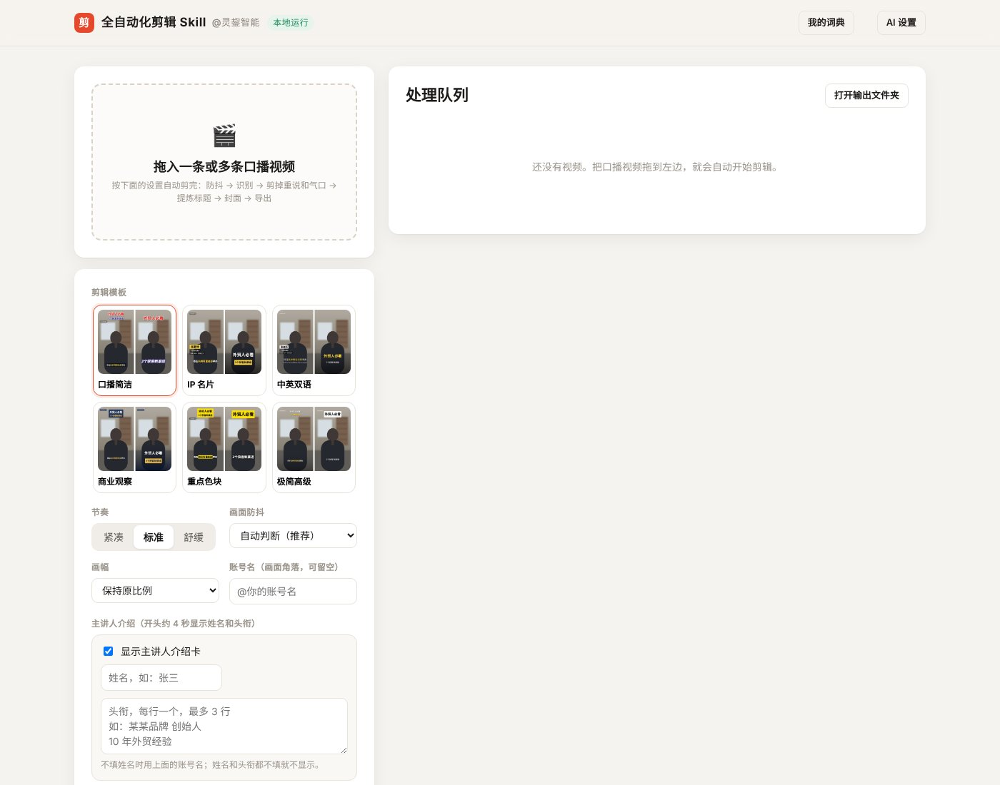
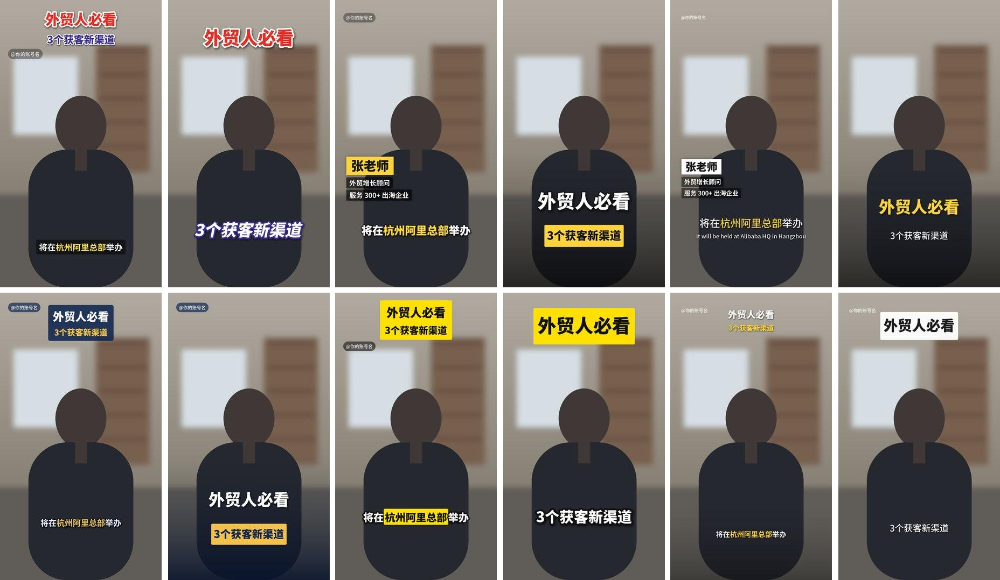

# 全自动化剪辑 Skill · @灵鋆智能

**把口播视频拖进去，自动出成片。** 一个在自己电脑上运行的口播短视频剪辑工具：自动识别字幕、剪掉停顿和说错重说、加字幕和动效、生成封面，批量导入、全自动处理。

- **完全本地运行**：解压即用，不用装 Python，也不用剪辑软件；视频不会上传到任何服务器。
- **免费**：语音识别模型在本机跑，不用买积分、不按分钟收费。
- **AI 可选**：接入 DeepSeek / 通义千问 / Kimi / 智谱等大模型后，剪得更准、错别字更少、还能做中英双语字幕（只发送文字，按服务商价格计费，口播文字量很小）；不接也能用。



## 下载使用

到 [**Releases**](../../releases/latest) 下载对应的安装包，**解压后双击启动**：

| 电脑 | 下载 | 启动 |
|---|---|---|
| Mac（M1 / M2 / M3 / M4 芯片） | `全自动化剪辑Skill-Mac-M芯片.zip` | 双击 `启动.command` |
| Mac（Intel 芯片，2020 年及以前） | `全自动化剪辑Skill-Mac-Intel.zip` | 双击 `启动.command` |
| Windows 10 / 11（64 位） | `全自动化剪辑Skill-Windows.zip` | 双击 `启动.bat` |

> - **Mac 第一次打开**如果提示“无法验证开发者”：右键点 `启动.command` → 打开 → 再点“打开”。只需要一次。
> - **Windows** 如果弹出“Windows 已保护你的电脑”：点“更多信息” → “仍要运行”。用系统自带的解压就行（右键 → 全部解压缩）。
> - 启动后会打开一个黑色窗口和浏览器页面，**用的时候不要关黑色窗口**。

详细说明见 [使用说明.md](使用说明.md)。

## 能做什么

把一条或多条口播视频拖进页面，每条按下面 6 步自动跑完，某一步出错可以从那一步重试：

| 步骤 | 做什么 |
|---|---|
| 防抖 | 自动判断镜头有没有晃：手机支架、三脚架这类固定机位不处理；手持晃动才防抖（轻柔 / 标准 / 强力可选） |
| 识别 | 本地语音识别（SenseVoice），得到每个字的时间 |
| 整理 | 剪掉停顿、气口、“嗯呃”、单独的口头禅（“那个”“然后”“就是说”）、说错重说和连说两遍的话；接入 AI 时由 AI 判断，再参考“我的词典”校对一轮错别字 |
| 标题 | 从文稿里提取活动名称、日期地点做标题，提取不到再用 AI 提炼 |
| 封面 | 按模板生成 9:16 和 3:4 两个封面 |
| 导出 | 字幕、关键词高亮、主讲人介绍卡、重点大字弹出、画质增强、人声降噪；文件名自动为“日期 + 标题” |

**6 个模板**（黄白为主色调，可以自己加模板）：



1 口播简洁 · 2 IP 名片 · 3 中英双语 · 4 商业观察 · 5 重点色块 · 6 极简高级（每组左边是成片画面，右边是封面）

**几个特色功能**

- **主讲人介绍卡**：填姓名和 2–3 行头衔，成片开头 4 秒左右在画面左侧显示（黄底姓名 + 深色底头衔）。
- **中英双语字幕**：模板 3，由 AI 逐句翻译，字幕文件里也带英文。
- **我的词典**：写下你常说的专有名词（已预置 Claude、ChatGPT、DeepSeek、智能体、大模型等常用 AI 名词），识别后自动纠正发音相近的错字；接入 AI 后还会参考词典再校对一轮，“克劳德”这种写法完全不同的也能改成“Claude”。
- **批量处理**：一次拖入多条，后台排队逐条处理；关掉再打开会接着处理。
- **可以手动修改**：每条都能打开校对字幕、恢复误删的句子、换模板、改标题，然后重新导出。

## 从源码运行（开发者）

需要 Python 3.10+：

```bash
git clone <本仓库地址>
cd auto-clip-skill
python3 -m pip install -r requirements.txt
python3 run.py
```

第一次运行会自动下载语音识别模型（约 230MB，带国内镜像）。FFmpeg 由 `imageio-ffmpeg` 自带，不用另外安装。

自己打包成“解压即用”的安装包：

```bash
bash scripts/prepare_runtime.sh     # 下载便携 Python、各平台依赖和模型到 build/
bash scripts/build_packages.sh      # 生成 dist/ 下的 Mac / Windows 安装包
```

## 自定义

- **模板**：在 `templates/` 下复制一个文件夹改名（如 `template7`），删掉里面的 `preview.jpg`，修改 `template.json` 的颜色、字号、位置等，重启后自动出现。参数说明见 [使用说明.md](使用说明.md) 的“新增模板”。
- **品牌名称**：修改根目录的 `edition.json`。

## 项目结构

```
app/
  server.py     本地服务（FastAPI）：任务队列、6 步流水线、接口
  engine.py     语音识别、断句、剪辑点、气口处理
  cleanup.py    逐字级清理：语气词、口头禅、卡顿、重说
  lexicon.py    我的词典：强制替换、英文名词写法、拼音模糊纠错
  ai.py         可选的大模型接口（OpenAI 兼容）：审阅、校对、翻译
  titles.py     标题提取        effects.py   重点大字、音效
  render.py     字幕、介绍卡、封面渲染和 FFmpeg 合成
  media.py      FFmpeg 工具、镜头晃动检测
  static/       网页界面
templates/      模板（JSON）    fonts/   思源黑体 / 宋体
vendor/         jieba、pypinyin  scripts/ 打包脚本
```

## 技术与致谢

| 环节 | 使用 |
|---|---|
| 语音识别 | [SenseVoice](https://github.com/FunAudioLLM/SenseVoice)（阿里通义实验室），通过 [sherpa-onnx](https://github.com/k2-fsa/sherpa-onnx) 本地运行 |
| 静音检测 | [Silero VAD](https://github.com/snakers4/silero-vad) |
| 分词、拼音 | [jieba](https://github.com/fxsjy/jieba)、[pypinyin](https://github.com/mozillazg/python-pinyin) |
| 剪辑合成、防抖 | [FFmpeg](https://ffmpeg.org/)（vid.stab），由 [imageio-ffmpeg](https://github.com/imageio/imageio-ffmpeg) 提供 |
| 文字渲染 | [Pillow](https://python-pillow.org/)，字体为 [思源黑体 / 思源宋体](https://github.com/notofonts/noto-cjk)（SIL OFL 1.1） |
| 便携运行环境 | [python-build-standalone](https://github.com/astral-sh/python-build-standalone) |

本项目代码以 [MIT 协议](LICENSE) 开源。上面这些模型、字体和组件各自遵循它们自己的协议（安装包里附带的 FFmpeg 是 GPL 版本，语音识别模型遵循 FunASR 模型协议）。

---

全自动化剪辑 Skill · 灵鋆智能出品。欢迎提 Issue 和 PR。
